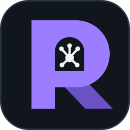
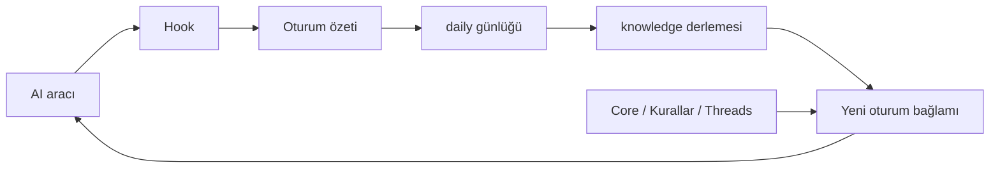

<div align="center">



# Respected Brain

### Ajanlar değişir. Ortak hafıza sizin kasanızda kalır.

Yerel bir Markdown not kasasını AI araçlarınıza bağlayan açık kaynak hafıza programı.

<br>

[](https://github.com/respected0/respected-brain/releases)
[](LICENSE)


[](https://obsidian.md)

**Claude Code** · **Codex** · **Cursor** · **Antigravity** · **Gemini CLI**

[Sorun](#sorun-ve-çözüm) · [Nasıl çalışır](#nasıl-çalışır) · [Özellikler](#özellikler) · [Kurulum](#kurulum) · [Sık sorulanlar](#sık-sorulanlar) · [Geliştirme](#geliştirme)

</div>

---

## Sorun ve çözüm

**Sorun.** AI araçları güçlü ama unutkan. Her oturum sıfırdan başlar; üç konuşma önce aldığınız karar, koyduğunuz kurallar,
projenin bağlamı kaybolur. Aracı değiştirince hepsini yeniden anlatırsınız.

**Çözüm.** Hafızayı araca değil **sizin not kasanıza** koyun. Brain oturumlarınızı özetleyip günlüğe yazar, günlüklerden bağlantılı
bilgi notları derler ve yeni oturum açıldığında ilgili bağlamı aracınıza verir. Araç değişir, hafıza kalır.

> Örnek: Antigravity ile çalışırken alınan bir karar kasaya yazılır; Codex aynı kasaya bağlıysa sonraki oturumunda bu bağlamı alır.

**Taşınan şey iş bağlamıdır:** kararlar, kurallar, günlük özetleri ve notlar. Sağlayıcıların hesapları ve ham sohbet geçmişleri
birleştirilmez.

## Nasıl çalışır



Bunun çalışması için o aracın bağlantısının açık, hook'unun etkin ve özetleyici aracın oturumunun açık olması gerekir. Her sohbetin
eksiksiz yakalandığı ya da özetlerin hatasız olduğu garanti edilmez.

## Özellikler

| | |
|---|---|
| **Oturum özetleri** | AI oturumları özetlenir ve günlüğe yazılır |
| **Bilgi derleme** | Günlüklerden bağlantılı `knowledge` notları derlenir |
| **Arama** | Varsayılan SQLite FTS5 tam metin arama; isteğe bağlı yerel anlamsal arama (Hub'dan açılır) |
| **Çoklu araç** | Hook ve MCP ile Claude Code, Codex, Cursor, Antigravity, Gemini CLI |
| **Obsidian uyumlu** | Kasa düz Markdown; Obsidian ile okuyup düzenleyebilirsiniz |
| **Ortak kasa** | İki ajan aynı kasayı kullanabilir; yazıcılar ortak bir kilit kullanır |
| **Notlarınız güvende** | Kasa hiçbir işlemle (kaldırma, onarım dahil) silinmez |

Model işleri (özetleme gibi) bilgisayarınızdaki AI aracının komut satırıyla yapılır; bu araç kendi sağlayıcısına bağlanır. "Yerel
kasa", AI işlemlerinin çevrimdışı olduğu anlamına gelmez.

## Kurulum

Windows'ta `RespectedBrain-Windows-Setup.exe` kullanıcı başına kurulur, **yönetici izni istemez, Python gerekmez**. Kurucu iki yol sunar:

- **Respected Hub ile devam et:** Hub'ı kurar ve Brain'i Hub'da açar.
- **Yalnızca Brain:** kimlik, not kasası ve bağlantıları kendisi sorar.

Kurucuyu yeniden çalıştırmak onarır/günceller, ayarları değiştirir ya da kaldırır. Ayrıntılar: [Kullanım rehberi](docs/USAGE.md).

| Ne | Nerede |
|---|---|
| Program | `%LOCALAPPDATA%\Respected\RespectedBrain\app` (kurucunun) |
| Ayarlar ve çalışma verisi | `%LOCALAPPDATA%\Respected\RespectedBrain\data` |
| Not kasası | Kurulumda seçtiğiniz yer (varsayılan `Belgeler\RespectedOS`); hiçbir işlem silmez |

Kurulumdan sonra her şey Hub olmadan da yapılır:

```powershell
respected-brain config set briefing_time=07:30
respected-brain repair
respected-brain uninstall
```

Bütün komutlar: [docs/COMMANDS.md](docs/COMMANDS.md).

## Sık sorulanlar

<details>
<summary><b>Ek API anahtarı gerekir mi?</b></summary>

<br>

Hayır. Model işleri bilgisayarınızdaki AI aracının komut satırıyla yapılır; o aracın hesabı, kotası ve ağ erişimi geçerlidir.
Ücretsiz ya da sınırsız model kullanımı vaat edilmez.

</details>

<details>
<summary><b>Özetleyiciyi değiştirebilir miyim?</b></summary>

<br>

`respected-brain config set summary_provider=codex`. Bu, kod yazdığınız ajanı değiştirmez; yalnızca özetleri hangi aracın çıkardığını belirler.

</details>

<details>
<summary><b>İki ajan aynı kasayı kullanabilir mi?</b></summary>

<br>

Evet; programın yazıcıları ortak bir kilit kullanır. Aynı notu iki editörde elle değiştirmek yine de çakışabilir.

</details>

<details>
<summary><b>Arama anlamsal mı?</b></summary>

<br>

Varsayılan arama SQLite FTS5 tam metin aramasıdır. İsteğe bağlı yerel anlamsal arama Hub'dan açılır; açılmadıkça hiçbir şey indirilmez.

</details>

<details>
<summary><b>Programı kaldırırsam notlarım?</b></summary>

<br>

Kasa hiçbir durumda silinmez. Ayarlar ve çalışma verisi varsayılan olarak kalır; kaldırırken isterseniz onlar da silinir.

</details>

<details>
<summary><b>Hangi platformlar?</b></summary>

<br>

Beta yalnızca Windows'u destekler. macOS ve Linux kurulum betikleri var ama doğrulanmadı.

</details>

## Geliştirme

```powershell
python -m pip install -e ".[dev]"
python -m unittest discover -s tests -t .                   # HOME ve AppData geçici klasöre yönlenir
python packaging/build_dist.py --platform windows --output dist
python -m unittest tests.packaging.test_distribution
python packaging/build_installer.py                         # dist\RespectedBrain-Windows-Setup.exe
```

Kaynak `src/respected_brain/`, paketle gelen içerik (kasa şablonu, beceriler, talimatlar) `src/respected_brain/resources/`, kurucu
`packaging/windows/brain_setup.iss`.

## Belgeler

| Belge | Konu |
|---|---|
| [USAGE.md](docs/USAGE.md) | Kullanım rehberi |
| [COMMANDS.md](docs/COMMANDS.md) | Bütün komutlar |
| [ARCHITECTURE.md](docs/ARCHITECTURE.md) | Mimari ve güvenlik sınırları |
| [PRODUCT_CONTRACT.md](docs/PRODUCT_CONTRACT.md) | Üç ürünün ortak sözleşmesi |
| [ROADMAP.md](docs/ROADMAP.md) | Yol haritası |

Ekosistemin diğer ürünleri: [Respected Hub](https://github.com/respected0/respected-hub) ·
[Respected Orchestrator](https://github.com/respected0/respected-orchestrator).

## Atıf ve lisans

Bilgi derleme yaklaşımı [Andrej Karpathy'nin LLM bilgi tabanı deseninden](https://gist.github.com/karpathy/442a6bf555914893e9891c11519de94f)
ilham alır. Proje [Avenox Beyin](https://github.com/avenoxai/avenoxbeyin) MIT lisanslı geçmişinden doğdu; commit geçmişi ve atıf korunur.
[MIT lisansı](LICENSE).
