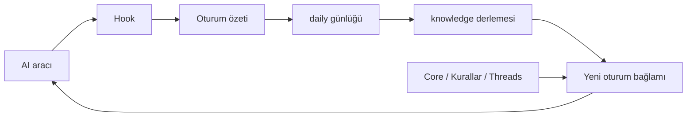

<div align="center">

# 🧠 Respected Brain (SecondBrain)

### Ajanlar değişir. Ortak hafıza sizin kasanızda kalır.

Claude Code · Codex · Cursor · Antigravity · Gemini CLI

</div>

Respected Brain, yerel bir Markdown not kasasını AI araçlarınıza bağlayan açık kaynak bir hafıza programıdır. AI
oturumlarınızı özetleyip günlüğe yazar, günlüklerden bağlantılı bilgi notları derler, notlarınızı arar ve bunları AI
araçlarına hook ve MCP üzerinden sunar. Kasayı [Obsidian](https://obsidian.md) ile okuyup düzenleyebilirsiniz.

Kaynak kod: [respected0/respected-secondbrain](https://github.com/respected0/respected-secondbrain).

**Taşınan şey iş bağlamıdır:** kararlar, kurallar, günlük özetleri ve notlar. Sağlayıcıların hesapları ve ham sohbet
geçmişleri birleştirilmez. Özetleme gibi model işleri bilgisayarınızdaki AI aracının komut satırıyla yapılır; bu araç
kendi sağlayıcısına bağlanır. "Yerel kasa", AI işlemlerinin çevrimdışı olduğu anlamına gelmez.

## Nasıl çalışır?



Örnek: Antigravity ile çalışırken alınan bir karar kasaya yazılır; Codex aynı kasaya bağlıysa sonraki oturumunda bu
bağlamı alır. Bunun için o aracın bağlantısının açık, hook'unun etkin ve özetleyici aracın oturumunun açık olması gerekir.
Her sohbetin eksiksiz yakalandığı ya da özetlerin hatasız olduğu garanti edilmez.

## Kurulum

Windows'ta `RespectedSecondBrain-Windows-Setup.exe` kullanıcı başına kurulur, yönetici izni istemez, Python gerekmez.
Kurucu iki yol sunar: **Respected Hub ile devam et** (Hub'ı kurar ve SecondBrain'i Hub'da açar) ya da **Yalnızca
SecondBrain** (kimlik, not kasası ve bağlantıları kendisi sorar). Kurucuyu yeniden çalıştırmak onarır/günceller, ayarları
değiştirir ya da kaldırır. Ayrıntılar: [Kullanım rehberi](docs/USAGE.md).

| Ne | Nerede |
|---|---|
| Program | `%LOCALAPPDATA%\Respected\RespectedBrain\app` (kurucunun) |
| Ayarlar ve çalışma verisi | `%LOCALAPPDATA%\Respected\RespectedBrain\data` |
| Not kasası | Kurulumda seçtiğiniz yer (varsayılan `Belgeler\RespectedOS`); hiçbir işlem silmez |

Kurulumdan sonra her şey Hub olmadan da yapılır: `respectedbrain config set briefing_time=07:30`, `respectedbrain repair`,
`respectedbrain uninstall`. Bütün komutlar: [Komutlar](docs/COMMANDS.md).

## Sık sorulanlar

**Ek API anahtarı gerekir mi?** Hayır. Model işleri bilgisayarınızdaki AI aracının komut satırıyla yapılır; o aracın
hesabı, kotası ve ağ erişimi geçerlidir. Ücretsiz ya da sınırsız model kullanımı vaat edilmez.

**Özetleyiciyi değiştirebilir miyim?** `respectedbrain config set summary_provider=codex`. Bu, kod yazdığınız ajanı
değiştirmez; yalnızca özetleri hangi aracın çıkardığını belirler.

**İki ajan aynı kasayı kullanabilir mi?** Evet; programın yazıcıları ortak bir kilit kullanır. Aynı notu iki editörde
elle değiştirmek yine de çakışabilir.

**Arama anlamsal mı?** Varsayılan arama SQLite FTS5 tam metin aramasıdır. İsteğe bağlı yerel anlamsal arama Hub'dan
açılır; açılmadıkça hiçbir şey indirilmez.

**Programı kaldırırsam notlarım?** Kasa hiçbir durumda silinmez. Ayarlar ve çalışma verisi varsayılan olarak kalır;
kaldırırken isterseniz onlar da silinir.

**Hangi platformlar?** Beta yalnızca Windows'u destekler. macOS ve Linux kurulum betikleri var ama doğrulanmadı.

## Geliştirme

```powershell
python -m pip install -e ".[dev]"
python -m unittest discover -s tests -t .                   # HOME ve AppData geçici klasöre yönlenir
python packaging/build_dist.py --platform windows --output dist
python -m unittest tests.packaging.test_distribution
python packaging/build_installer.py                         # dist\RespectedSecondBrain-Windows-Setup.exe
```

Kaynak `src/respectedbrain/`, paketle gelen içerik (kasa şablonu, beceriler, talimatlar) `src/respectedbrain/resources/`,
kurucu `packaging/windows/secondbrain_setup.iss`. Mimari ve güvenlik sınırları: [docs/ARCHITECTURE.md](docs/ARCHITECTURE.md). Üç ürünün
ortak sözleşmesi ekosistem kökündeki `docs/PRODUCT_CONTRACT.md` dosyasındadır.

## Atıf ve lisans

Bilgi derleme yaklaşımı [Andrej Karpathy'nin LLM bilgi tabanı deseninden](https://gist.github.com/karpathy/442a6bf555914893e9891c11519de94f)
ilham alır. Proje [Avenox Beyin](https://github.com/avenoxai/avenoxbeyin) MIT lisanslı geçmişinden doğdu; commit geçmişi ve
atıf korunur. [MIT lisansı](LICENSE).
